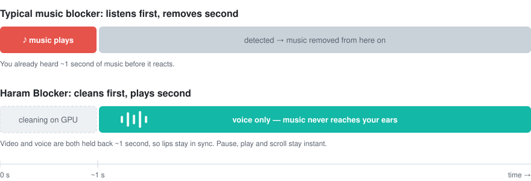
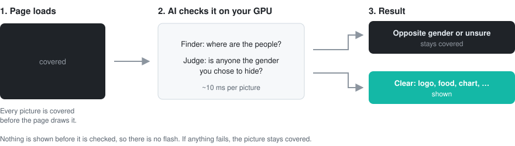
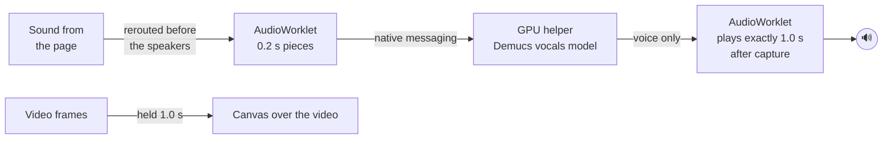
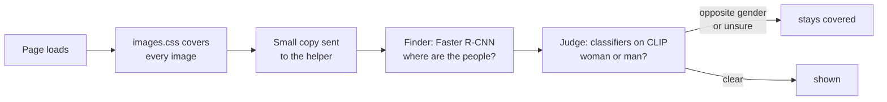

<p align="center">
  
</p>

<h1 align="center">Haram Blocker</h1>

<p align="center">
  <b>Keep haram out of your browser, live.</b><br>
  Music is removed from every video before you hear a single note.<br>
  Pictures of the opposite gender are covered before you see them.<br>
  Porn sites, and any site you choose, never open.<br>
  All on your own GPU. Nothing leaves your computer.
</p>

<p align="center">
  <a href="LICENSE"></a>
  
  
  
  
</p>

---

Most blockers react after the fact. The music starts, the extension notices, and *then* it mutes. The picture appears, and *then* it gets blurred. That first moment is exactly what you were trying to avoid.

Haram Blocker works the other way round: **check first, show second.** Nothing reaches your eyes or ears until an AI model on your graphics card has cleared it.

| | 🔇 Music | 🖼️ Images | 🚫 Sites |
|---|---|---|---|
| **What it does** | Removes instruments and beats from any video, keeps the voices | Covers pictures that show the gender you choose to hide ("I am a man" → women are covered, and the other way round) | Blocks ~950,000 porn sites out of the box, plus any site (or part of a site) you add |
| **Timing** | Voice plays ~1 s after a video starts; pause, play and scroll stay instant | Covered from the first frame, shown a moment later if clear | Stopped before a single byte of the site loads |
| **If anything fails** | Silence, never the original | Stays covered, never shown | Chrome itself does the blocking |
| **Instead you get** | The voice | A solid color or blur | A verse of the Quran, recited, and a reminder |

## 🔇 Music removal

Every video's sound goes through an AI model on your graphics card **before** it is played. The model separates the voice from the instruments, the instruments are thrown away, and you only ever hear the voice.

<p align="center">
  
</p>

- **Zero leak by design.** The audio is cleaned before playback. If a piece isn't ready in time, you hear silence, never the original. If the helper crashes, everything stays silent.
- **Keeps the voice.** Talks, vlogs, podcasts, news and reels stay watchable. Only the instruments and beats disappear.
- **Lips stay in sync.** The picture is held back by the same second as the voice.
- **Instant controls.** Pause, play and scrolling to the next reel react immediately. Only a *new* video waits about a second while its voice is cleaned.
- **Works on any site.** It hooks every `<video>`, `<audio>` and Web Audio output in Chrome, not a list of supported sites. Tested on YouTube (including Shorts and Stable Volume) and X.
- **Works with blur extensions.** If another extension blurs a video, the blur also covers Haram Blocker's delayed picture. Because that picture is shown 1 s late, a blur that reacts up to a second late still lands *before* you see the frame.

## 🖼️ Image hiding

Pick **"I am a man"** or **"I am a woman"** in the menu. Every picture on every site starts covered and is shown only after the AI has checked it.

<p align="center">
  
</p>

- **No flash.** The cover is applied before the page draws anything, so a picture can't appear even for one frame before it's checked.
- **Unsure means covered.** If the AI isn't sure, or the check fails, the picture stays covered.
- **Logos and graphics stay visible.** Logos, icons, charts and patterns are recognised as harmless, so websites stay usable (about 1% of them covered by mistake).
- **Photos, art and close-ups.** It looks at each person close up *and* at the whole picture, which also catches drawings, paintings and body close-ups.
- **Works on real sites.** Normal images, SVG images, and pictures drawn as backgrounds (X/Twitter shows every photo this way) are all checked. When a site swaps a picture, the new one is covered again at once.
- **Your choice of cover.** Solid black (default), any color, or blur. Two strictness levels: **strict** (default) and **balanced**.
- **Trained and tested properly.** The classifiers were trained on audited public data and measured on a separate quiz set they never saw ([details](helper/training/README.md)).

## 🚫 Site blocker

Porn sites are blocked from the moment you install. You can add any other site, or just part of one (`youtube.com/shorts` blocks Shorts but keeps the rest of YouTube).

- **Nothing loads.** Chrome stops the site before any of it is downloaded, including when it's embedded inside another site.
- **A reminder instead.** The blocked page shows a verse of the Quran in Arabic and English, recited by Mishary Rashid Alafasy, and a short reminder: the small days you hold back are the bricks your life is built from. The verse changes each time.
- **Unblocking takes a moment of honesty.** A 30-second pause with a verse about the nafs, then you type *"I am choosing my desire over what I know is better."* Pasting doesn't work. The same applies to turning off the built-in porn list.
- **Mercy after a slip.** If you unblocked something, the next blocked page opens with *"Despair not of the mercy of Allah"* (Az-Zumar 39:53), not with blame.
- **Catches in-page jumps.** Sites like YouTube switch to Shorts without loading a new page; that is caught too.
- **A list that was checked.** ~950,000 sites from two public lists, with entries that aren't porn removed: shared hosting names that would block thousands of unrelated sites, and newspapers, shops, search engines and the like found by checking the 30,000 most-visited sites ([details](tools/adult-list)).

## Also

- **Allowed list.** Sites and YouTube channels you trust (Quran recitation, for example) play untouched, with no delay. Ads on allowed channels are still cleaned.
- **Private.** Everything runs on your machine. No servers, no accounts, no analytics, and nothing leaves your computer.
- **Idle means idle.** When nothing is playing and no new pictures appear, the GPU does nothing. The site blocker needs no GPU at all.

## Performance

Measured on an RTX 5060 Ti:

| | |
|---|---|
| Music removed | about **65 dB** quieter, effectively silent |
| Voice quality | live streaming matches whole-file separation |
| GPU while a video plays | about **17–20%**, **~22 W** extra, **~400–700 MB** VRAM (image check adds ~1 GB VRAM when on) |
| GPU when nothing is playing | **0%**. The card stays in its lowest power state. |
| Processing time per 0.2 s piece | about **35 ms**, well inside the 1 s budget |
| Image check | about **8–13 ms** per image; a page of 32 images is ready in ~0.6 s |
| Image check, quiz of ~2,300 photos + art + graphics never used in training | strict: **0.17%** of photos with a woman shown, **0.26%** with a man; logos/icons/charts ~1% hidden by mistake ([details](helper/training/README.md)) |

## Install

**You need:** Linux, Google Chrome (or Chromium or Brave), an NVIDIA GPU with a recent driver, and [`uv`](https://docs.astral.sh/uv/).

```sh
git clone https://github.com/kaiserkonok/haram-blocker.git
cd haram-blocker
./install.sh
```

The script creates a Python environment with CUDA PyTorch (a large, one-time download), fetches the model, and registers the helper with Chrome.

Then load the extension:

1. Open `chrome://extensions`
2. Turn on **Developer mode** (top right)
3. Click **Load unpacked** and pick the `extension` folder

That's it. Chrome starts the helper automatically, and it's ready about 5 seconds after Chrome opens. Click the extension icon to see its status, turn on image hiding ("I am a man" / "I am a woman"), block sites and manage your allowed list.

> If you use another music-blocking, image-blurring or site-blocking extension, turn it off. Two extensions doing the same job interfere with each other and use your GPU twice.

## How it works

### Music removal



1. **Interception.** A content script runs before any page script and reroutes every media element and every Web Audio graph into a cleaner. Nothing can reach the speakers directly.
2. **Streaming separation.** An `AudioWorklet` cuts the sound into 0.2 s pieces and sends them, through the extension, to a local Python helper. The helper runs the vocals model of [Demucs](https://github.com/adefossez/demucs) (`htdemucs_ft`) over a sliding 4 s window with 0.4 s of look-ahead, so every returned sample was separated with context on both sides. Seams are crossfaded.
3. **Fixed-delay playback.** Each cleaned piece is tagged with the exact sample it belongs to and played 1.0 s after capture. Missing pieces play as silence. That fixed delay is what makes zero-leak possible.
4. **Lip sync.** Video frames are captured with `requestVideoFrameCallback` and drawn 1.0 s late onto a canvas that sits over the video.
5. **Instant controls.** Pausing freezes the whole delay line, sound and picture together. Resuming continues from the buffer, so there's no wait. Switching videos drops the queue at once.

### Image hiding



The stylesheet is injected before the page draws, so images are covered from the first frame. The finder ([Faster R-CNN MobileNetV3](https://pytorch.org/vision/stable/models/faster_rcnn.html), torchvision) locates people. Two small classifiers trained on top of [CLIP](https://github.com/openai/CLIP) ViT-B/16 then decide: one looks at each person close up, the other at the whole image (catching drawings, paintings, body close-ups and people the finder missed). They were trained on audited, public data and tested on a separate quiz set; see [helper/training](helper/training/README.md). Images the page won't let the extension read are downloaded again by the extension, shrunk to 512 px and sent to the helper. Results are cached. Sound always takes priority on the GPU, so a page full of images never causes gaps in the voice.

<details>
<summary><b>Project layout</b></summary>

```
extension/
  manifest.json
  src/inject.js      page script: reroutes audio, lip-sync canvas, allowed list
  src/worklet.js     real-time chunking and fixed-delay playback
  src/images.js      sends images to be checked, shows the clear ones
  src/images.css     covers every image until it is checked
  src/bridge.js      connects the page to the extension
  src/background.js  keeps the GPU helper running, routes audio, site blocking rules
  blocker/           the blocked page: verse, recitation, reminder, unblocking
  rules/adult.json   built-in porn-site list (generated)
  popup/             status, image hiding, blocked and allowed sites
helper/
  host.py            native messaging host, streaming separation on CUDA
  vision.py          image check: finder + judge
  test_stream.py     voice quality, music leak, real-time timing
  test_vision.py     image check accuracy on labeled photos
tests/
  e2e_test.py        full browser test: music removal, lip sync, controls
  e2e_images_test.py full browser test: images covered from the first frame
  e2e_blocker_test.py full browser test: site blocking, unblocking, verses
tools/
  adult-list/        builds rules/adult.json from public lists, with reviewed exclusions
  quran/             builds the verse file (Tanzil) and downloads the recitation
install.sh
```
</details>

## FAQ

**Does it remove singing?**
No. The model separates *vocals* from *instruments*, and a singing voice is a vocal. Instruments, beats and background scores are removed, but a song's singer remains.

**Why is there a one-second wait when a video starts?**
That's the time it takes to clean the audio before you hear it. It's the price of never hearing music. Pausing, resuming and scrolling stay instant.

**Does image hiding cover everything?**
No. Only pictures with someone of the gender you chose to hide stay covered. Logos, food, buildings, charts and pictures with only your own gender are shown.

**Can I use only one of the two?**
Yes. Image hiding is off until you pick "I am a man" or "I am a woman". Music removal can be skipped on any site or channel with the allowed list.

**Does it run all the time?**
The models stay loaded in VRAM so videos and pages are fast, but they only compute while sound is playing or new pictures appear. When you're idle, GPU use is zero.

**Does it work without an NVIDIA GPU?**
Not yet. AMD (ROCm), Apple Silicon and CPU support are on the roadmap. On CPU, the model is too slow for live use today.

**Does it work on Windows or macOS?**
Not yet. The extension is cross-platform, and the helper only needs a different installer. Contributions are welcome.

**Why not just mute videos with music?**
Because most videos with background music are worth watching: lectures, vlogs, news, tutorials. Muting throws the voice away with the music.

## Limitations

- Linux + NVIDIA + Chromium-based browsers only, for now.
- Videos from servers that block cross-origin access (some TikTok CDNs) can't be read by Web Audio, so they play silent rather than unfiltered.
- Image hiding covers ``, SVG images and backgrounds set in an element's own style. Backgrounds set from a site's stylesheet, video posters and images inside shadow DOM are not covered yet. Videos themselves are not checked for people yet.
- The image check can miss very small people in crowds, and some drawings and statues.
- No list contains every porn site; new ones appear daily. Image hiding still covers the pictures on sites the list misses.
- Chrome doesn't let an extension stop you from switching it off on the `chrome://extensions` page.
- If a site puts the bare `<video>` element into fullscreen, the lip-sync canvas can't cover it. The audio is still cleaned, but the picture may run 1 s ahead.

## Roadmap

- [ ] Windows and macOS installers
- [ ] AMD / Apple Silicon / CPU backends
- [ ] Lower start delay (smaller pieces on fast GPUs)
- [ ] Check video frames for people, using the 1 s buffer that already exists (cover videos, not just pictures)
- [x] Pictures drawn as backgrounds (X/Twitter)
- [ ] Backgrounds from stylesheets, video posters
- [ ] Firefox support
- [ ] Chrome Web Store release

## Development

```sh
# helper only: voice quality, music leak and real-time timing
helper/.venv/bin/python helper/test_stream.py music.mp3 speech.wav

# image check accuracy (eval.json lists photos with a female/male/mixed/none group)
helper/.venv/bin/python helper/test_vision.py eval.json photos/

# full browser tests (need Playwright and its Chromium)
python tests/e2e_test.py music.mp3 speech.wav
python tests/e2e_images_test.py eval.json photos/
python tests/e2e_blocker_test.py

# rebuild the built-in porn-site list / the verse file
python tools/adult-list/build.py
python tools/quran/build_verses.py && tools/quran/fetch_audio.sh
```

The tests mix a speech recording over music, so the perfect answer is known. They check that the music-only part comes out silent, the voice comes through, the first second is silent, there are no gaps, and that pause, resume and video switching are instant.

Helper logs: `~/.local/state/haram-blocker/helper.log`

Issues and pull requests are welcome. If music ever leaks through, or a picture is shown that should have been covered, please open an issue with the link.

## Credits

Source separation by [Demucs](https://github.com/adefossez/demucs) (Alexandre Défossez, Meta AI), MIT license. People detection by [torchvision](https://github.com/pytorch/vision) Faster R-CNN, BSD license. Image understanding by [CLIP](https://github.com/openai/CLIP) (OpenAI) via [OpenCLIP](https://github.com/mlfoundations/open_clip), MIT license. Image accuracy measured on [COCO](https://cocodataset.org) photos. Quran text and Pickthall's translation from the [Tanzil Project](https://tanzil.net), used verbatim. Recitation by Mishary Rashid Alafasy via [EveryAyah](https://everyayah.com), downloaded at install. Arabic font [Amiri Quran](https://github.com/aliftype/amiri) (OFL). Porn-site lists by the [Block List Project](https://github.com/blocklistproject/Lists) (Unlicense) and [Steven Black](https://github.com/StevenBlack/hosts) (MIT).

## License

[MIT](LICENSE)
