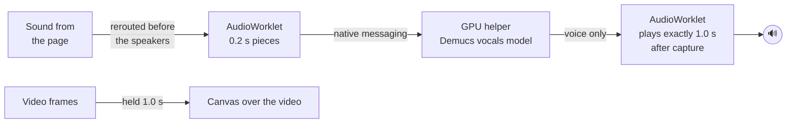

<p align="center">
  
</p>

<h1 align="center">Haram Blocker</h1>

<p align="center">
  <b>Watch any video without the music.</b><br>
  The music is removed live, on your own GPU, <i>before</i> a single note reaches your ears.
</p>

<p align="center">
  <a href="LICENSE"></a>
  
  
  
  
</p>

---

Most music blockers listen first and act second. Music starts playing, the extension notices, and *then* it mutes. That first second is exactly the part you were trying to avoid.

Haram Blocker flips the order. Every video's sound goes through an AI model on your graphics card **before** it is played. The model separates the voice from the instruments, the instruments are thrown away, and you only ever hear the voice.

<p align="center">
  
</p>

## Features

- **Zero leak by design.** The audio is cleaned before playback. If a piece isn't ready in time, you hear silence, never the original. If the helper crashes, everything stays silent.
- **Keeps the voice.** Talks, vlogs, podcasts, news and reels stay watchable. Only the instruments and beats disappear.
- **Lips stay in sync.** The picture is held back by the same second as the voice.
- **Instant controls.** Pause, play and scrolling to the next reel react immediately. Only a *new* video waits about a second while its voice is cleaned.
- **Works on any site.** It hooks every `<video>`, `<audio>` and Web Audio output in Chrome, not a list of supported sites. Tested on YouTube and YouTube Shorts; reports from other sites are welcome.
- **Allowed list.** Sites and YouTube channels you trust (Quran recitation, for example) play untouched, with no delay. Ads on allowed channels are still cleaned.
- **Private.** Everything runs on your machine. No servers, no accounts, no analytics, and nothing leaves your computer.

## Performance

Measured on an RTX 5060 Ti:

| | |
|---|---|
| Music removed | about **65 dB** quieter, effectively silent |
| Voice quality | live streaming matches whole-file separation |
| GPU while a video plays | about **17–20%**, **~22 W** extra, **~400–700 MB** VRAM |
| GPU when nothing is playing | **0%**. The card stays in its lowest power state. |
| Processing time per 0.2 s piece | about **35 ms**, well inside the 1 s budget |

## Install

**You need:** Linux, Google Chrome (or Chromium or Brave), an NVIDIA GPU with a recent driver, and [`uv`](https://docs.astral.sh/uv/).

```sh
git clone https://github.com/kaiserkonok/haram-blocker.git
cd haram-blocker
./install.sh
```

The script creates a Python environment with CUDA PyTorch (a large, one-time download), fetches the model, and registers the helper with Chrome.

Then load the extension:

1. Open `chrome://extensions`
2. Turn on **Developer mode** (top right)
3. Click **Load unpacked** and pick the `extension` folder

That's it. Chrome starts the helper automatically, and it's ready about 5 seconds after Chrome opens. Click the extension icon to see its status and manage your allowed list.

> If you use another music-blocking extension, turn it off. Two extensions capturing the same audio will interfere with each other.

## How it works



1. **Interception.** A content script runs before any page script and reroutes every media element and every Web Audio graph into a cleaner. Nothing can reach the speakers directly.
2. **Streaming separation.** An `AudioWorklet` cuts the sound into 0.2 s pieces and sends them, through the extension, to a local Python helper. The helper runs the vocals model of [Demucs](https://github.com/adefossez/demucs) (`htdemucs_ft`) over a sliding 4 s window with 0.4 s of look-ahead, so every returned sample was separated with context on both sides. Seams are crossfaded.
3. **Fixed-delay playback.** Each cleaned piece is tagged with the exact sample it belongs to and played 1.0 s after capture. Missing pieces play as silence. That fixed delay is what makes zero-leak possible.
4. **Lip sync.** Video frames are captured with `requestVideoFrameCallback` and drawn 1.0 s late onto a canvas that sits over the video.
5. **Instant controls.** Pausing freezes the whole delay line, sound and picture together. Resuming continues from the buffer, so there's no wait. Switching videos drops the queue at once.

<details>
<summary><b>Project layout</b></summary>

```
extension/
  manifest.json
  src/inject.js      page script: reroutes audio, lip-sync canvas, allowed list
  src/worklet.js     real-time chunking and fixed-delay playback
  src/bridge.js      connects the page to the extension
  src/background.js  keeps the GPU helper running, routes audio
  popup/             status and allowed list
helper/
  host.py            native messaging host, streaming separation on CUDA
  test_stream.py     voice quality, music leak, real-time timing
tests/
  e2e_test.py        full browser test with Chromium + extension + helper
install.sh
```
</details>

## FAQ

**Does it remove singing?**
No. The model separates *vocals* from *instruments*, and a singing voice is a vocal. Instruments, beats and background scores are removed, but a song's singer remains.

**Why is there a one-second wait when a video starts?**
That's the time it takes to clean the audio before you hear it. It's the price of never hearing music. Pausing, resuming and scrolling stay instant.

**Does it run all the time?**
The model stays loaded in VRAM so videos start quickly, but it only computes while sound is actually playing. When nothing plays, GPU use is zero.

**Does it work without an NVIDIA GPU?**
Not yet. AMD (ROCm), Apple Silicon and CPU support are on the roadmap. On CPU, the model is too slow for live use today.

**Does it work on Windows or macOS?**
Not yet. The extension is cross-platform, and the helper only needs a different installer. Contributions are welcome.

**Why not just mute videos with music?**
Because most videos with background music are worth watching: lectures, vlogs, news, tutorials. Muting throws the voice away with the music.

## Limitations

- Linux + NVIDIA + Chromium-based browsers only, for now.
- Videos from servers that block cross-origin access (some TikTok CDNs) can't be read by Web Audio, so they play silent rather than unfiltered.
- If a site puts the bare `<video>` element into fullscreen, the lip-sync canvas can't cover it. The audio is still cleaned, but the picture may run 1 s ahead.

## Roadmap

- [ ] Windows and macOS installers
- [ ] AMD / Apple Silicon / CPU backends
- [ ] Lower start delay (smaller pieces on fast GPUs)
- [ ] Firefox support
- [ ] Chrome Web Store release

## Development

```sh
# helper only: voice quality, music leak and real-time timing
helper/.venv/bin/python helper/test_stream.py music.mp3 speech.wav

# full browser test (needs Playwright and its Chromium)
python tests/e2e_test.py music.mp3 speech.wav
```

The tests mix a speech recording over music, so the perfect answer is known. They check that the music-only part comes out silent, the voice comes through, the first second is silent, there are no gaps, and that pause, resume and video switching are instant.

Helper logs: `~/.local/state/haram-blocker/helper.log`

Issues and pull requests are welcome. If music ever leaks through, please open an issue with the video link.

## Credits

Source separation by [Demucs](https://github.com/adefossez/demucs) (Alexandre Défossez, Meta AI), MIT license.

## License

[MIT](LICENSE)
